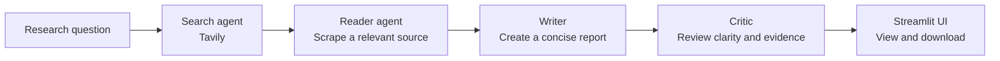

# Multi-Agent Research Studio

**A question in. A sourced research brief out.**

Research Studio turns an open-ended question into a concise report through a four-agent workflow. A Streamlit interface makes each stage visible and keeps the report, research notes, source links, and review together.

## How it works



- **Search:** finds a small set of relevant web sources.
- **Reader:** selects a source and extracts key facts.
- **Writer:** combines the findings into a focused report with source URLs.
- **Critic:** provides a short quality review.

The research input is deliberately bounded to help control model token usage.

## Built with

Python, Streamlit, LangChain, Groq (`openai/gpt-oss-120b`), Tavily, Requests, and BeautifulSoup.

## Run locally

Requires Python 3.14+ and API keys for Groq and Tavily.

1. Create a `.env` file in the project root:

   ```env
   GROQ_API_KEY=your_groq_api_key
   TAVILY_API_KEY=your_tavily_api_key
   ```

2. Install dependencies and launch the app:

   ```powershell
   uv sync
   .\.venv\Scripts\Activate.ps1
   streamlit run .\app.py
   ```

Enter a question such as **“How is AI changing data analysis?”** The app shows pipeline progress and provides tabs for the final report, research notes, and critic review, plus a Markdown download.

For deployment, configure `GROQ_API_KEY` and `TAVILY_API_KEY` as secrets in the hosting platform and start the app with `streamlit run app.py`. Never commit your `.env` file.

## Project structure

| File | Purpose |
| --- | --- |
| `app.py` | Streamlit user interface |
| `pipeline.py` | Coordinates the four research stages |
| `agents.py` | Agent prompts and Groq model chains |
| `tools.py` | Tavily web search and page scraping |
